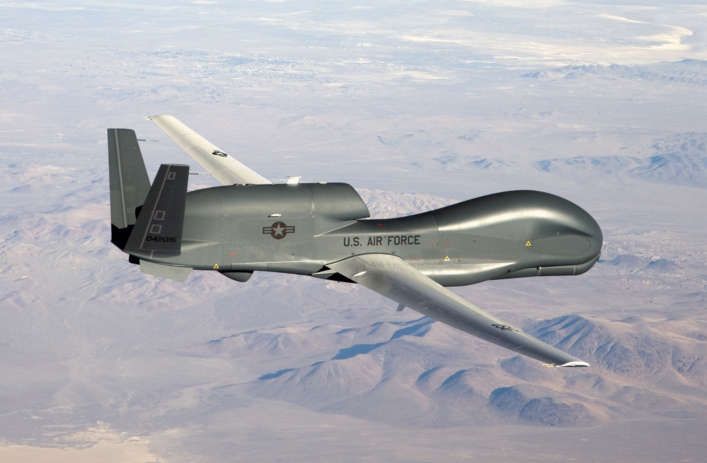
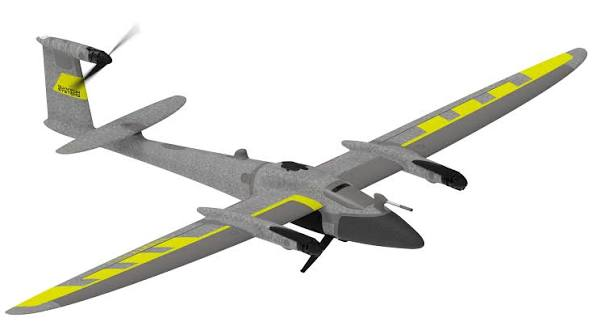

# Daily Research Log

Project: Eagle  
Researcher: [@Mitansh05](https://github.com/Mitansh05)  
Start Date: 2026-10-19

## Entry: 2026-10-25

1. Objectives for Today
   - Find what makes a fixed wing UAV
   - Look at real life examples
   - Figure out which components are need for a UAV.

2. Objectives Completed

3. Research Notes
   - In my research i would out that in order for an aircraft to be categorized as a fixed wing UAV it needs to be an Unmanned Aerial Vehicle (UAV), that flies using rigid wings and is designed for sustained flights, like a normal aircraft.
   - Some real world examples of a fixed wing UAV are the following:
     - Northrop Grumman RQ-4 Global Hawk
       

     - Quantum-Systems Trinity Pro
       

   - Some key components for a UAV are the following:
     - Wings: Fixed wings that provide necessary lift, ideally these need to be designed for gliding. For my design I am thing of having basics wings designed for gliding for maximum efficiency.

     - Propulsion System: This what will power the UAV, and according to my skills, experience and my project level I found that an electric motor will be enough to power my UAV, ideally a brushless motor for more efficiency.

     - Control Surfaces: These are things like ailerons, elevators, and rudders that are needed to adjust the flight path and maneuver. For my design I can use basic small servos to control the control surfaces.

     - Autopilot System: Many fixed wing UAV have an autopilot system for navigation and stability. For my design as of now I am thinking that I can have a basic altitude hold or a bank angle hold for the autopilot system.

4. Sources Consulted
   - [Source](https://quantum-systems.com/blog/geo/fixed-wing-drone-the-complete-guide-for-professionals/) / Fixed Wing Drone: The Complete Guide for Professionals

   - [Source](https://www.researchgate.net/figure/Example-of-a-fixed-wing-UAV-The-Northrop-Grumman-RQ-4-Photo-courtesy-of-Northrop_fig2_353727266) / Example Of Fixed-Wing UAV: The Northrop Grumman RQ

**End of log**
